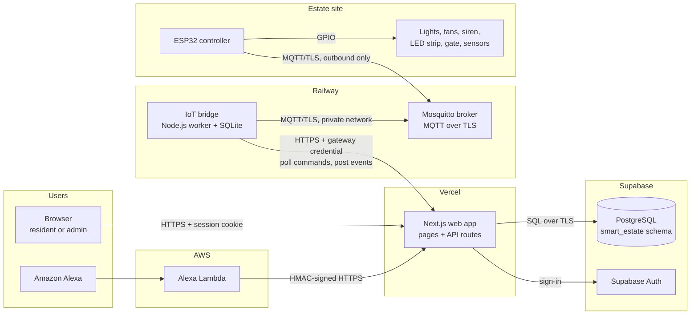
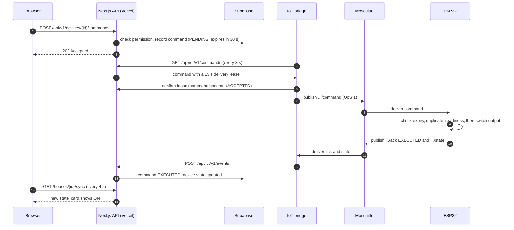

# Nexora Technical Overview

How the Nexora web app, cloud services and ESP32 estate controller fit together: the technologies used and why, the physical devices, and how a tap in the browser becomes a light switching on in a house.

Based on the `nexora`, `smart-estate-firmware` and `smart-estate-backend` repositories as of November 2026.

## 1. Overview

Nexora controls and secures a residential estate: individual houses with their own lights, fans and intrusion sensors, plus shared estate equipment such as the entrance gate, perimeter lighting, a big fan, a siren and a perimeter motion sensor.

There are two kinds of user:

- **Residents** (house owners) control and arm their own house.
- **Estate administrators** manage every house, the shared equipment, residents and controllers.

Both use the same web app. Residents can also use voice through Amazon Alexa.

The system has four layers, each with one job:

| Layer | Runs on | Job |
|---|---|---|
| Web app and API | Vercel | Next.js pages for residents and admins, plus the server API that authorizes every action and records it. |
| Database and sign-in | Supabase | PostgreSQL holds the single source of truth: estates, houses, devices, commands, events and security modes. Supabase Auth handles accounts. |
| IoT bridge and broker | Railway | A Mosquitto MQTT broker the controllers connect to, and a bridge worker that relays between MQTT and the cloud API. |
| Estate controller | On site | An ESP32 that drives lights, fans, siren, LED strip and gate motor, reads motion and distance sensors, and enforces local safety limits. |

## 2. Architecture

The cloud never connects directly to the controller. The controller keeps one outbound, encrypted MQTT connection to the broker. The bridge sits next to the broker, polls the cloud API for work, and forwards controller messages back. The estate network therefore needs no open inbound ports, and the database credentials never leave Vercel.

Every arrow starts at the side that opens the connection. Nothing connects inward to the estate.

## 3. Technology stack

### Web app and API

| Technology | Version | Used for | Why |
|---|---|---|---|
| Next.js (App Router) | 16.4.6 | Resident and admin pages, and the server API under `/api` | One codebase serves the UI and the API, deploys as serverless functions on Vercel, and keeps secrets server-side. |
| React + React Compiler | 19.2 | UI components and state | Component model with automatic memoization, so live device cards re-render cheaply. |
| TypeScript | 5 | All web, API and bridge code | Shared types for devices, commands and API contracts catch mismatches at build time. |
| Tailwind CSS + shadcn/ui (Radix) | 4 | Styling and accessible components (sidebar, switches, sliders, dialogs) | Consistent design system with keyboard and screen-reader support built in. |
| Recharts, Framer Motion, dnd-kit, Sonner | | Charts, animation, drag-and-drop automation builder, notifications | Small, focused libraries for the dashboard's interactive parts. |
| Zod | 4.6 | Input validation | Rejects malformed input before it reaches the database. |
| postgres.js | 4.1 | SQL from API routes to Supabase | Lightweight driver that works with Supabase's transaction pooler from serverless functions, with strict query timeouts. |
| @supabase/ssr | 0.12 | Cookie-based sessions | Sessions in secure HTTP-only cookies, verified server-side on every request. |
| Web Speech API | Browser | Nexora AI voice assistant (speech in and out) | Hands-free control in the browser. Commands are interpreted by a rule-based engine in the app; no external AI service is called. |

### Cloud data and hosting

| Technology | Used for | Why |
|---|---|---|
| Vercel | Hosts the web app and API | Managed HTTPS, global edge, preview deployments per branch, no servers to maintain. |
| Supabase PostgreSQL | Estates, houses, rooms, devices, device state, commands, events, security modes, controllers, OAuth grants, audit records | Relational data with strong consistency; transactions make commands and audit records atomic. Row-level security and SQL authorization functions (`can_view_house`, `can_control_house`, `is_estate_admin`) keep access rules in one place. |
| Supabase Auth | Accounts, sign-in, email confirmation | Proven auth service; no password handling in Nexora's own code. |
| Railway | Runs the Mosquitto broker and the IoT bridge as Docker services | Long-running processes with persistent volumes and a raw TCP proxy for MQTT, which serverless platforms cannot provide. |
| AWS Lambda | Alexa Smart Home skill endpoint | Amazon requires the skill to run as a Lambda; it only forwards signed requests to Nexora. |

### IoT messaging

| Technology | Version | Used for | Why |
|---|---|---|---|
| MQTT | 3.1.1 | All controller communication | Built for small devices on unreliable networks: persistent connection, tiny packets, delivery guarantees (QoS 1) and a "last will" message when a device drops off. |
| Eclipse Mosquitto | 2.0.22 | MQTT broker | Lightweight, widely used broker with TLS, per-user passwords and per-topic access control lists. |
| IoT bridge (Node.js + mqtt.js) | Node 24, mqtt 5.14 | Relays commands and events between the broker and the cloud API | Keeps database credentials out of the estate path and turns serverless HTTP into a persistent MQTT session. |
| SQLite (`node:sqlite`, WAL) | Built in | Bridge's durable queue of claimed commands and outgoing events | Nothing is lost if the bridge restarts or the cloud is briefly unreachable. |

### Controller firmware

| Technology | Version | Used for | Why |
|---|---|---|---|
| ESP32 | Dual-core, Wi-Fi | Estate controller | Built-in Wi-Fi and TLS, plenty of GPIO, low cost, strong Arduino support. |
| Arduino framework via PlatformIO | espressif32 6.12 | Build system and runtime | Reproducible builds with pinned libraries, several build profiles (production, diagnostics, commissioning) and native unit tests. |
| C++17 | | Firmware language | Small, testable modules (command processor, gate controller, security zones) that also compile on a PC for tests. |
| 256dpi MQTT | 2.5.2 | MQTT client | Simple client with last-will and QoS 1 support. |
| WiFiClientSecure | Core | TLS to the broker | Verifies the broker's certificate against a pinned CA. |
| ArduinoJson | 7.4.3 | Message parsing and building | Bounded memory use when decoding commands. |
| AccelStepper | 1.64 | Gate stepper motor | Smooth acceleration and non-blocking movement. |
| Adafruit NeoPixel | 1.12.5 | Perimeter RGB LED strip | Standard driver for SK6812/WS2812 addressable LEDs. |
| WebServer, Preferences (NVS), mDNS, SNTP | Core | Wi-Fi setup portal, saved Wi-Fi profiles, local broker discovery, clock sync | The clock must be synchronized because every command carries an expiry time. |
| Unity (PlatformIO native tests) | | Firmware unit tests on a PC | Safety logic is tested without hardware. |

### Voice integration

| Technology | Used for | Why |
|---|---|---|
| Alexa Smart Home API (v3) | "Alexa, turn on the living room light" for lights and fans | Native Alexa device control without a custom voice model. Gates, sirens and security modes are deliberately excluded. |
| OAuth 2.0 account linking | Connects an Alexa account to a Nexora account | Alexa gets a short-lived (15-minute) token scoped to `alexa:smart_home`; the user's password is never shared. |
| Login with Amazon (PKCE) | Linking from the Nexora Settings page | Lets residents link Alexa from the website, not only from the Alexa app. |

> **Spring Boot backend.** A separate Java 21 / Spring Boot 4.1 API (`smart-estate-backend`) with Flyway migrations, session login and Server-Sent Events implements the same API contract. The web app can point at it (`BACKEND` mode) for local development, or run fully in the browser with simulated devices (`MOCK` mode). The deployed path described in this document is `CLOUD` mode: Next.js API routes with Supabase.

## 4. Devices and wiring

One ESP32 controller serves two houses and the shared estate equipment. Every device belongs to exactly one **scope**: a house, or the estate.

| Device | Scope | GPIO | Hardware | Controls |
|---|---|---|---|---|
| House 1 lights 1 and 2 | House 1 | 16, 17 | LEDs with resistors (transistor driver for larger lamps) | On / off |
| House 2 lights 1 and 2 | House 2 | 18, 19 | LEDs with resistors | On / off |
| House 1 fan | House 1 | 23 | 12 V fan via MOSFET module, active-high | On / off |
| Big fan | Estate | 21 | Fan driver, active-low | On / off, 30 s safety limit |
| Siren | Estate | 13 | 12 V siren via MOSFET driver | Sound for a set time, stop; sounds automatically on intrusion |
| Perimeter LED strip | Estate | 22 | SK6812 RGB strip, 60 LEDs, brightness capped at 50% | On / off, brightness, colour; flashes red during an alarm |
| Entrance gate | Estate | 25, 26, 27, 14 | 28BYJ-48 stepper via ULN2003 driver | Open, close, stop |
| Gate limit switches | Estate | 36, 39 | Open and closed end-stops, external pull resistors | Confirm the gate really reached an end |
| Perimeter motion sensor | Estate | 32 | PIR sensor | Triggers the perimeter alarm when the perimeter is armed |
| House 1 motion sensor | House 1 | 33 | PIR sensor inside House 1 | Triggers the House 1 alarm when House 1 is armed |
| House 1 and 2 entrance sensors | House 1, House 2 | 4/34, 5/35 | Ultrasonic distance sensors (trigger/echo), 5 V echo reduced to 3.3 V by voltage dividers | Detect a change in entrance distance when the house is armed |

### Power

- An LM2596 buck converter provides a regulated 5 V rail for the ESP32, sensors, ULN2003 and LEDs.
- 12 V loads (fan, siren) run from a fused 12 V distribution block, never through the breadboard or an ESP32 pin.
- All low-voltage grounds meet at one common reference so signals read correctly.

### Safety built into the firmware

- **Readiness flags.** Each output stays disabled until its wiring is verified and its flag (for example `SMART_ESTATE_SIREN_READY`) is switched on in the private `config.h`.
- **Safe boot.** Every output is driven to "off" before it is configured, so nothing switches on during a restart.
- **Time limits.** Fans, siren and gate movement have hard time limits, and the gate stops on a timeout or contradictory limit-switch readings.
- **Command checks.** Expired commands, replayed commands and commands received before the clock is synchronized are rejected.

## 5. MQTT messaging

All messages are JSON. Topics follow one pattern, and the broker's access list only lets each controller use the topics for its own devices.

| Topic | Direction | Purpose |
|---|---|---|
| `smartestate/v1/{scope}/{device}/command` | Cloud → controller | Turn on, turn off, set brightness or colour, open gate, sound siren. Carries a command ID and an expiry time. |
| `smartestate/v1/{scope}/{device}/ack` | Controller → cloud | Command result (ACCEPTED, EXECUTED or FAILED) with the device's real state. |
| `smartestate/v1/{scope}/{device}/state` | Controller → cloud | Reported state after any change, for example `{"on": true}`. |
| `smartestate/v1/{scope}/{device}/status` | Controller → cloud | Device availability (ONLINE / UNAVAILABLE). Retained, so the latest value is always available. |
| `smartestate/v1/{scope}/{device}/event` | Controller → cloud | Motion detected, motion cleared, security alarm raised. |
| `smartestate/v1/controllers/{id}/heartbeat` | Controller → cloud | Every 15 s: firmware version, Wi-Fi network and signal, uptime, hardware readiness. |
| `smartestate/v1/controllers/{id}/security-mode` | Cloud → controller | Armed or disarmed state for each house and the perimeter, with a version number and expiry. |
| `smartestate/v1/controllers/{id}/provisioning` | Cloud → controller | Opens or closes the on-site Wi-Fi setup window. |

Commands, acknowledgements, events and heartbeats use QoS 1 (delivered at least once) and are not retained. Every message carries a unique ID, so a message delivered twice is recognized and handled only once.

## 6. End-to-end flows

### Turning a device on

A command that is not confirmed within 30 seconds is marked TIMEOUT, so the app never shows a device as switched when the controller did not confirm it.

### Arming security and raising an alarm

1. A resident arms their house (or an admin arms the perimeter). The API records the new mode and increases its version number.
2. The bridge picks up the change through `GET /api/iot/v1/bridge/sync` and publishes it to the controller's `security-mode` topic. Modes expire after 60 seconds and are refreshed, so a controller never acts on a stale mode.
3. After a 10-second grace period, the zone is live. Motion on that zone's own sensor raises a `SECURITY_ALARM` event: the siren sounds and the perimeter strip flashes red, all on the controller, without waiting for the cloud.
4. The event travels back through the bridge and appears in the app's security history and the admin activity feed.

Each sensor only alarms for its own zone: the perimeter motion sensor needs the perimeter armed, and the House 1 motion sensor needs House 1 armed.

### Knowing whether a controller is online

The controller sends a heartbeat every 15 seconds. The cloud shows it as degraded after 35 seconds of silence and offline after 50 seconds. When a controller goes offline, its devices are shown as offline and new commands to them are refused. If the connection drops suddenly, the broker also publishes the controller's last-will "offline" message.

### Setting up Wi-Fi on site

1. An estate admin opens a setup window for the controller from the admin Controllers page (2 to 10 minutes).
2. The request reaches the controller through the bridge. The controller starts its own password-protected setup network. It also does this automatically if it has been offline for over a minute.
3. The installer joins that network and enters the controller's proof code and the new Wi-Fi details.
4. The controller tests the new network and the MQTT connection, and only then saves it. If either fails, it returns to the previous network.

Wi-Fi passwords are entered locally and never pass through the cloud or MQTT.

### Voice control with Alexa

1. The resident links Alexa to Nexora once, from the Settings page or the Alexa app.
2. "Alexa, turn on the kitchen light" reaches the Nexora Lambda, which signs the request with a shared secret (HMAC-SHA256, valid for 5 minutes) and forwards it to `/api/integrations/alexa/directives`.
3. Nexora checks the Alexa token, finds the device among the lights and fans that resident is allowed to control, and submits the command through the same path as the web app.
4. It waits up to 5 seconds for the controller to confirm, then tells Alexa the real result.

## 7. Security model

| Boundary | Protection |
|---|---|
| Browser to API | Supabase session in HTTP-only cookies, verified on each request. State-changing requests need a CSRF token. Security headers (HSTS, no framing, no content sniffing). |
| Access rules | Every query checks permission with SQL functions such as `can_control_house`. Residents reach only their house; estate admins reach their estate. Row-level security is enabled on all tables. |
| Bridge to API | A gateway ID and secret credential, compared in constant time. The bridge has no database access and no user session. |
| Controller to broker | TLS with a pinned CA certificate. Each controller has its own password and may only use its own topics. The firmware refuses unencrypted MQTT outside a private network. |
| Commands | Each has a UUID and an expiry. The controller rejects expired, duplicate and replayed commands, and anything received before its clock is synchronized. |
| Alexa | Requests signed with HMAC-SHA256. OAuth tokens are stored only as hashes; Amazon refresh tokens are encrypted with AES-256-GCM. |
| Secrets | Wi-Fi and MQTT credentials live in the controller's private `config.h`, which is excluded from git. Server secrets live in Vercel and Railway environment settings. |
| Audit | Commands, owner changes and security-mode changes are written to an audit record with the user who made them. |

## 8. Reliability

- **No double actions.** Each command carries a client request ID, so pressing a button twice or retrying a request creates one command, not two.
- **Delivery leases.** The bridge claims commands for 15 seconds. If it crashes, the command becomes available again instead of being lost.
- **Durable bridge queue.** Claimed commands and outgoing events are written to SQLite before anything is sent, and retried with backoff while the cloud is unreachable.
- **Clear outcomes.** A command ends as EXECUTED, FAILED or TIMEOUT. The app shows what the device actually reported, not what was requested.
- **Malformed messages are dropped and logged** rather than blocking the queue behind them.
- **Local safety first.** Alarms, siren limits and fan limits run on the controller, so they work even if the internet connection is down.

## 9. Repositories

| Repository | Contents | Tests |
|---|---|---|
| `nexora` | Next.js web app and API, Supabase SQL migrations, IoT bridge, Mosquitto configuration, Alexa Lambda | Node test runner, TypeScript, ESLint |
| `smart-estate-firmware` | ESP32 firmware, PlatformIO build profiles, hardware diagnostic sketches, wiring guide | Unity native tests |
| `smart-estate-backend` | Spring Boot API used for local development and the original backend mode | JUnit, Mockito, Testcontainers |
